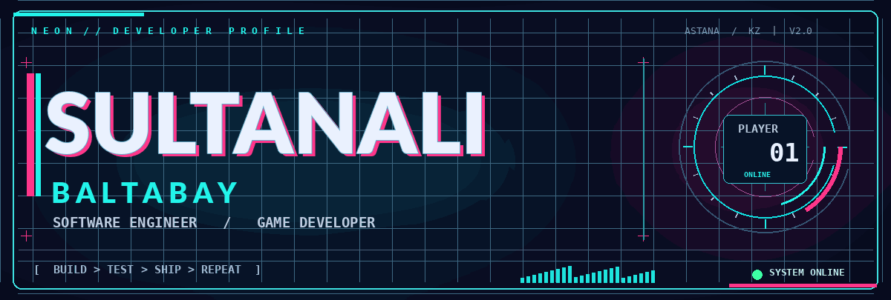

[Uploading README.md…]()
<!-- ╔════════════════════════════════════════════════════════════════╗ -->
<!-- ║  SULTANALI // NIGHT SHIFT  |  GITHUB PROFILE  |  BUILD 02       ║ -->
<!-- ╚════════════════════════════════════════════════════════════════╝ -->

<div align="center">



<br />

**`< PLAYER 01 / SULTANALI BALTABAY >`**

*Software Engineering student at Astana IT University · Building games, systems, and better code.*

<a href="#-01--operator-profile"></a>
<a href="#-02--tech-loadout"></a>
<a href="#-03--featured-builds"></a>
<a href="#-04--mission-log"></a>

</div>

---

## ◈ 01 / OPERATOR PROFILE

```text
╔══════════════════════[   IDENTITY://PLAYER_01   ]══════════════════════╗
║                                                                        ║
║    > NAME       Sultanali Baltabay                                    ║
║    > CLASS      Software Engineering Student                          ║
║    > BASE       Astana, Kazakhstan                                    ║
║    > UNIVERSITY Astana IT University                                  ║
║    > SPECIALTY  Programming / Game Development                        ║
║                                                                        ║
║    [ ● ONLINE ]   [ BUILD IN PROGRESS ]   [ NEXT LEVEL: INCOMING ]    ║
║                                                                        ║
╚════════════════════════════════════════════════════════════════════════╝
```

I'm **Sultanali Baltabay**, a Software Engineering student who enjoys turning ideas into **working projects** — from algorithms and Java applications to interactive games.

I care about **how software feels**, not only whether it runs: responsive controls, polished interfaces, readable code, and the small details that make a project memorable.

> **MISSION DIRECTIVE:** Learn deeply. Build consistently. Polish the details. Ship something real.

---

## ◈ 02 / TECH LOADOUT

<div align="center">

**LANGUAGES**


**TOOLS / ENGINES**


**CURRENT FOCUS**

`DATA STRUCTURES` &nbsp; `ALGORITHMS` &nbsp; `OOP` &nbsp; `GAMEPLAY SYSTEMS` &nbsp; `UI / UX`

</div>

---

## ◈ 03 / FEATURED BUILDS

**Selected public repositories** — code, assignments, and projects I am building my experience with.

|  | Build | Focus |
| :---: | :--- | :--- |
| `01` | **[RPG Character Builder](https://github.com/sultanalibaltabai-alt/rpg-character-builder)** | Java · Object-oriented programming |
| `02` | **[Divide & Conquer](https://github.com/sultanalibaltabai-alt/assignment-divide-and-conquer)** | Java · Algorithms |
| `03` | **[DAA Assignment 2](https://github.com/sultanalibaltabai-alt/Assignment2_DAA)** | Java · Design and analysis of algorithms |
| `04` | **[ITP Final Project](https://github.com/sultanalibaltabai-alt/ITP_FinalProject)** | Python · Programming |
| `05` | **[Web Assignment](https://github.com/sultanalibaltabai-alt/Assignment-1-web)** | HTML · Web development |

### 🎮 Games under construction

| Project | Mode | Status |
| :--- | :--- | :--- |
| **НЕ ШУМИ!** (*Don't Make Noise!*) | Stealth horror · Sound-driven enemy AI | `IN DEVELOPMENT` |
| **AKARI — Night District** | Neon driving · Arcade racing | `IN DEVELOPMENT` |

<sub>Development projects are shown as works in progress, not released games. Screenshots, playable builds, and source links will be added when ready.</sub>

---

## ◈ 04 / MISSION LOG

```text
┌───────────────────────  ACTIVE QUESTS  ───────────────────────┐
│                                                             │
│  [ACTIVE]  Strengthen Java, C++, and programming fundamentals│
│  [ACTIVE]  Practice algorithms and software design          │
│  [ACTIVE]  Improve game prototypes and gameplay feel        │
│  [NEXT]    Publish polished project demos and documentation │
│  [GOAL]    Junior developer role / internship               │
│                                                             │
│  > There is no final level. Keep building.                  │
└─────────────────────────────────────────────────────────────┘
```

---

## ◈ 05 / TRANSMISSION

<div align="center">

**Open to learning, collaboration, and opportunities to build real software.**

<a href="https://github.com/sultanalibaltabai-alt"></a>
<a href="https://github.com/sultanalibaltabai-alt?tab=repositories"></a>

```text
> INITIATE NEXT PROJECT...
> BUILD. TEST. IMPROVE. SHIP.
> _
```

<sub>DESIGNED LIKE A GAME HUD · BUILT LIKE A DEVELOPER PORTFOLIO</sub>

</div>
